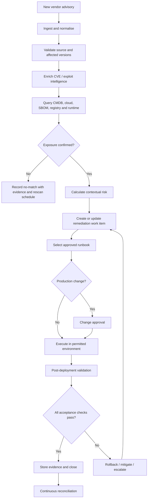

# 3. Automation reference architecture

## Automation goal

Move from manual advisory review and ticket creation to a controlled closed-loop process:

**Identify → Correlate → Prioritise → Assign → Remediate → Verify → Monitor**

Automation should accelerate repeatable work, not bypass production governance.

## Event-driven workflow

## Trigger sources

- Vendor advisory feed or webhook.
- CVE/NVD update.
- CISA Known Exploited Vulnerabilities catalogue update.
- Scheduled vulnerability scan.
- New SBOM or container image.
- New cloud asset or runtime deployment.
- Policy violation or expired exception.

## Automation stages

### 1. Ingest and normalise
Capture advisory ID, CVE, vendor, product, affected versions, fixed versions, severity, configuration conditions, source URL and timestamps. Preserve raw source data.

### 2. Correlate
Match product/package identifiers and version ranges against:
- CMDB and cloud asset inventory.
- SBOM and package manifests.
- Container registry image layers.
- Runtime/package telemetry.
- Kubernetes workload and node inventory.
- CI/CD build and deployment metadata.

Use version-aware package matching. Account for vendor backports and distribution package revisions.

### 3. Prioritise
Generate an explainable risk record. Example dimensions:
- Severity.
- Known exploitation.
- External reachability.
- Privilege and blast radius.
- Business criticality.
- Code-path applicability.
- Compensating controls.

A score must not hide the underlying evidence or override mandatory policy.

### 4. Create accountable work
Create or update ITSM work with affected assets, service owner, risk rationale, recommended fix, required evidence, target date and escalation path. Deduplicate by advisory + affected component + service/deployment group.

### 5. Select remediation path
- VM/package: approved OS/package patch orchestration.
- Container: rebuild from fixed base/dependency, scan, sign and redeploy.
- Kubernetes: update workload image/node/runtime through controlled rollout.
- Application dependency: update lockfile, test, build and deploy.
- Managed runtime: apply provider-supported runtime update or migration.
- Unsupported/EOL: migrate, isolate, disable exposure or document approved exception.

### 6. Guarded execution
- Use least-privilege workload identity.
- Test in non-production first.
- Run unit, integration, security and health checks.
- Use canary/rolling deployment where appropriate.
- Require human change approval for high-impact production changes.
- Provide rollback or mitigation path.

### 7. Verify closure
A ticket is not proof of remediation. Require:
- Running asset identity and timestamp.
- Installed package/runtime version or immutable image digest.
- Successful rollout/health result.
- Relevant post-change scan.
- Change record and approver where required.
- Evidence link and final status.

## Automation safety controls

| Control | Required behaviour |
|---|---|
| Idempotency | Reprocessing the same event must not create duplicate work or repeat unsafe actions |
| Approval | Production change gates follow risk and change policy |
| Scope | Enforce account, subscription, project and environment boundaries |
| Secrets | Use managed identity/short-lived credentials |
| Rate limiting | Protect APIs and production systems |
| Retry | Exponential backoff and bounded retry |
| Failure handling | Dead-letter queue and owner notification |
| Rollback | Defined rollback/mitigation before execution |
| Audit | Record actor, policy, action, result and evidence |
| Exceptions | Named approver, rationale, compensating control and expiry |

## Human-in-the-loop boundaries

Automate discovery, correlation, enrichment, prioritisation recommendations, ticket routing, test execution and evidence collection.

Require explicit approval where an action may disrupt production, change a critical service, affect regulated data, or alter shared infrastructure. Never auto-disable or take an entire service offline based only on an unverified CVE match.
