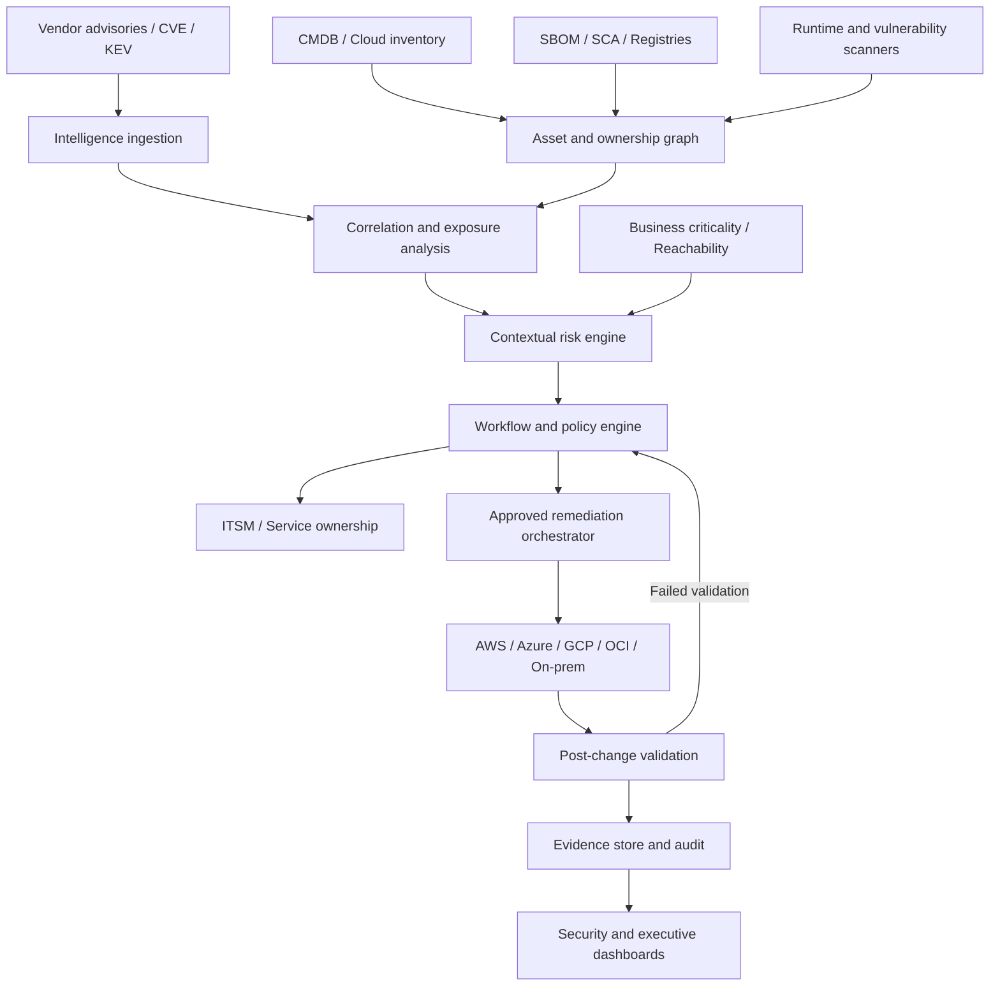

# 2. Proposed solution architecture

## Architecture objective

Create a central capability that converts security intelligence into prioritised, owned, automated and verifiably closed remediation work across hybrid and multi-cloud estates.

## Logical architecture

## Capability layers

### A. Intelligence
- Ingest vendor advisories and CVE records.
- Preserve source URL, publication/update time and affected/fixed version semantics.
- Enrich with exploit status and known-exploited signals.
- Track confidence and source provenance.

### B. Asset and dependency context
- Correlate cloud resources, VMs, containers, clusters, registries and repositories.
- Link SBOM components to deployed artifacts and running workloads.
- Resolve service owner, environment, data sensitivity and business criticality.
- Track last-seen time and inventory confidence.

### C. Exposure and risk
Do not use CVSS as the only priority signal. Evaluate:
- Vendor severity and vector.
- Known exploitation and exploit maturity.
- Network reachability and exposure.
- Vulnerable component presence and code-path applicability.
- Privilege and blast radius.
- Business service criticality and data classification.
- Existing compensating controls.
- Remediation complexity and outage risk.

The output should be an explainable priority with the evidence and policy that produced it.

### D. Workflow and orchestration
- Deduplicate findings into actionable remediation units.
- Assign accountable service and platform owners.
- Apply policy-driven due dates and escalation.
- Select an approved platform-specific runbook.
- Require change approval for production-impacting actions.
- Support mitigation or isolation when patching is not immediately possible.

### E. Verification and evidence
- Confirm package/runtime version in the running environment.
- Confirm container image digest and deployment rollout.
- Re-run applicable scanner or compliance check.
- Execute application health, smoke and regression tests.
- Record change ID, asset IDs, timestamps, results and evidence location.
- Reopen or escalate if validation fails.

## Architectural decisions

| Decision | Recommendation |
|---|---|
| Control plane | Central policy, correlation and workflow |
| Execution plane | Native cloud/platform tools and existing CI/CD |
| Integration | API and event-driven where supported |
| Identity | Managed/workload identity and least privilege |
| Data | Canonical asset IDs, provenance and freshness |
| Resilience | Retry, idempotency, dead-letter handling |
| Safety | Approval gates, canary rollout and rollback |
| Audit | Append-only event/evidence history |

## Non-functional requirements

- Scale ingestion independently from remediation execution.
- Make all automation idempotent.
- Handle duplicate, delayed and out-of-order events.
- Enforce tenant/account/subscription boundaries.
- Encrypt data in transit and at rest.
- Minimise secrets; prefer short-lived workload identity.
- Provide observable workflow state and actionable failure reasons.
- Retain evidence according to organisational policy.
