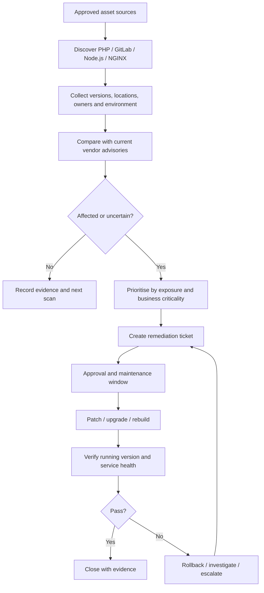

# Solution architecture — PHP, GitLab, Node.js and NGINX

## Objective

Provide one simple operational workflow to identify, assess, remediate and verify the four technologies named in the security roundup.

## Scope

- PHP runtimes, including PHP-FPM where deployed.
- GitLab Self-Managed instances.
- Node.js runtimes on hosts, in containers and in build/deployment environments.
- NGINX packages/builds, enabled modules and relevant configuration.

GitLab.com and vendor-managed services should be handled according to the provider's responsibility model; do not treat them as customer-managed servers.

## Logical flow

## Data to collect

| Field | Why it matters |
|---|---|
| Technology | PHP, GitLab, Node.js or NGINX |
| Asset/service ID | Stable identity for tracking |
| Host/container/image | Where the component runs |
| Environment | Development, test, staging, production |
| Owner/team | Who is accountable |
| Installed/runtime version | Version comparison |
| Package source | OS repository, vendor package, image, runtime manager |
| NGINX configuration/module facts | Needed to assess configuration-dependent exposure |
| Internet exposure | Helps order remediation |
| Last-seen timestamp | Avoids relying on stale inventory |
| Advisory/fixed-version reference | Traceability to vendor guidance |
| Ticket/change/evidence link | Audit and closure |

## Remediation paths

- **PHP:** Update the installed PHP package/runtime and relevant PHP-FPM service; confirm CLI and web-serving runtimes are aligned.
- **GitLab Self-Managed:** Follow GitLab's supported upgrade path and required intermediate upgrade stops; back up and validate before production changes.
- **Node.js:** Update the actual runtime used by the application, build agents and containers; rebuild and redeploy images where required.
- **NGINX:** Check the exact F5 advisory and distribution/vendor package guidance, enabled modules and affected configuration; validate configuration before reload/restart.

## Guardrails

- Never infer exposure from a product name alone.
- Check vendor and distribution backports before declaring a package vulnerable.
- Do not auto-disable production services based only on a version match.
- Use approved change windows and rollback plans.
- Confirm the running workload after deployment, not only the package repository or build pipeline.
